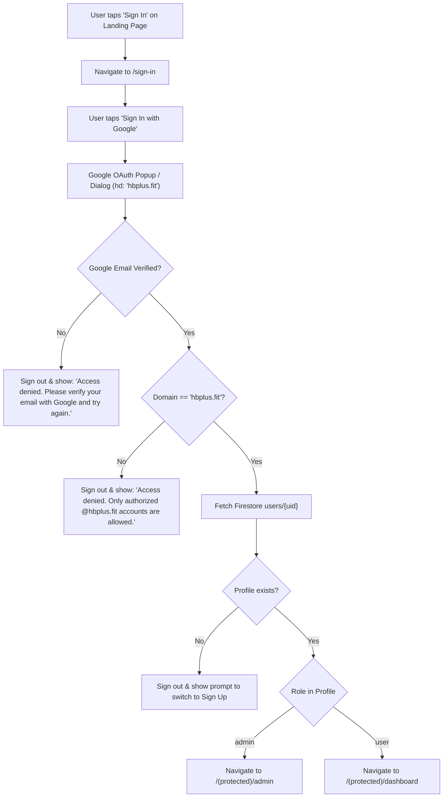
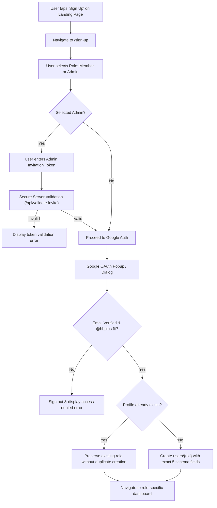

# HB+ — Enterprise Cross-Platform Mobile & Web Identity Platform

HB+ is a cross-platform enterprise mobile and web identity application engineered using React Native, Expo (SDK 58), React Native Web, Firebase Authentication, Cloud Firestore, and NativeWind (Tailwind CSS).

It enforces strict organizational domain restrictions (`@hbplus.fit`), verified email policies, zero-trust role-based access control (Member / Administrator), and a modern mobile-first SaaS user experience.

---

## Table of Contents
1. [Architecture Overview](#1-architecture-overview)
2. [Domain Policy & Verification Guard](#2-domain-policy--verification-guard)
3. [Zero-Scroll Mobile Landing Page Architecture](#3-zero-scroll-mobile-landing-page-architecture)
4. [Authentication Flows](#4-authentication-flows)
   - [Sign In Flow (Existing Users)](#sign-in-flow-existing-users)
   - [Sign Up Flow (New Users)](#sign-up-flow-new-users)
5. [Cloud Firestore User Schema](#5-cloud-firestore-user-schema)
6. [Firestore Security Rules](#6-firestore-security-rules)
7. [Environment Variables](#7-environment-variables)
8. [Google OAuth Configuration](#8-google-oauth-configuration)
9. [Development & Build Commands](#9-development--build-commands)
10. [Netlify Production Web Deployment](#11-netlify-production-web-deployment)
11. [Testing & Verification](#12-testing--verification)

---

## 1. Architecture Overview

HB+ delivers a unified codebase running simultaneously across:
- **Web Browsers:** Chrome, Safari, Edge, Firefox via React Native Web.
- **Android Applications:** Native APK / AAB via Expo Continuous Native Generation (CNG).
- **iOS Applications:** Native IPA via EAS Build.

### Key Technology Stack
- **Framework:** React Native 0.88, Expo SDK 58, Expo Router
- **Web Runtime:** React Native Web 0.21
- **Styling:** NativeWind 4.2 & Tailwind CSS 3.4
- **Language:** JavaScript ES6+ / JSX
- **Authentication:** Firebase Auth 13.4 with Google OAuth Provider & `@react-native-google-signin/google-signin`
- **Database:** Google Cloud Firestore
- **Security:** Zero-trust server-side validation & declarative Firestore Security Rules

---

## 2. Domain Policy & Verification Guard

### Strict Domain Requirement
The only permitted email domain for HB+ accounts is:
```
@hbplus.fit
```

### Validation Specifications:
- **Allowed:** `test@hbplus.fit`, `user123@hbplus.fit`, `admin@hbplus.fit`, `USER@HBPLUS.FIT` (case-insensitive).
- **Strictly Rejected:**
  - Non-organization domains: `*@gmail.com`, `*@yahoo.com`, `*@outlook.com`, `*@otherdomain.com`.
  - Non-matching TLDs: `*@hbplus.com`, `*@hbplus.org`.
  - Subdomains: `*@sub.hbplus.fit`, `*@corp.hbplus.fit`.
  - Incomplete / malformed addresses: `hbplus.fit`, `@hbplus.fit`.

### Required Exact Rejection Messages:
- Unauthorized domain error:
  > `"Access denied. Only authorized @hbplus.fit accounts are allowed."`
- Unverified Google email error:
  > `"Access denied. Please verify your email with Google and try again."`

Whenever an unauthorized or unverified email is provided, Firebase immediately executes `signOut(auth)` to revoke all tokens, and the client displays the rejection message without creating any database records.

---

## 3. Zero-Scroll Mobile Landing Page Architecture

To ensure an optimal mobile experience, the application implements a dedicated multi-route navigation model:

1. **Gateway Landing Page (`/`):**
   - Engineered to fit 100% within the initial mobile viewport with **zero scrolling required**.
   - Contains ONLY:
     - HB+ brand icon and glowing logo mark.
     - Short professional overview: *"Enterprise Identity & Access Management for authorized HB+ personnel."*
     - Security policy badge: *"Official Domain • @hbplus.fit"*.
     - Two prominent full-width action buttons:
       - **Sign In** &rarr; navigates to `/sign-in`
       - **Sign Up** &rarr; navigates to `/sign-up`
     - IT support contact & copyright note.
   - Contains **no login/registration input forms**, preserving clean mobile screen height.

2. **Dedicated Sign In Screen (`/sign-in`):**
   - Focused interface for returning users.
   - Clean back navigation to home.
   - Direct Google Sign In button.
   - Error banner with actionable dismiss.
   - Link: *"Don't have an account yet? Sign Up"*.

3. **Dedicated Sign Up Screen (`/sign-up`):**
   - Dedicated registration interface for new members and administrators.
   - Role Selection:
     - **Member (`user`):** Standard access.
     - **Admin (`admin`):** Requires an authorized Admin Invitation Token.
   - Admin token input field with show/hide toggle.
   - Direct Google Sign Up button.
   - Link: *"Already registered? Sign In"*.

4. **Backwards Compatibility (`/login`):**
   - Automatically redirects legacy bookmarks to `/sign-in`.

---

## 4. Authentication Flows

### Sign In Flow (Existing Users)


### Sign Up Flow (New Users)


---

## 5. Cloud Firestore User Schema

User profiles are stored in the `users` collection keyed by the Firebase Authentication UID (`users/{uid}`).

Every user profile conforms to this **exact 5-field schema**:

```json
{
  "name": "Alex Mercer",
  "email": "alex@hbplus.fit",
  "photoURL": "https://lh3.googleusercontent.com/...",
  "role": "user",
  "createdAt": "serverTimestamp()"
}
```

### Schema Rules:
- **`name`** *(string)*: Google display name (or default fallback).
- **`email`** *(string)*: Lowercase, verified `@hbplus.fit` Google email address.
- **`photoURL`** *(string)*: Google profile photo URL or empty string `""`.
- **`role`** *(string)*: Strictly `'user'` or `'admin'`.
- **`createdAt`** *(FieldValue)*: Firestore `serverTimestamp()`.
- **Duplicate Prevention:** Before creating a profile document, the service verifies whether `users/{uid}` already exists. Existing profiles are never overwritten.

---

## 6. Firestore Security Rules

Deploy the production rules located in `firestore.rules`:

```javascript
rules_version = '2';

service cloud.firestore {
  match /databases/{database}/documents {

    function isAuthenticated() {
      return request.auth != null;
    }

    function isVerifiedHbPlus() {
      return isAuthenticated() &&
        request.auth.token.email_verified == true &&
        request.auth.token.email.matches('.*@hbplus[.]fit$');
    }

    function isOwner(userId) {
      return isVerifiedHbPlus() && request.auth.uid == userId;
    }

    function isAdmin() {
      return isVerifiedHbPlus() &&
        get(/databases/$(database)/documents/users/$(request.auth.uid)).data.role == 'admin';
    }

    match /users/{userId} {
      // Users can only read their own profile; verified HB+ admins can read for oversight
      allow read: if isOwner(userId) || isAdmin();

      // Profile creation:
      // - Must be owner with verified @hbplus.fit account
      // - Strict schema enforcement: exact 5 fields only
      // - Role must be 'user' or 'admin'
      // - Email in document must match authenticated email token
      allow create: if isOwner(userId)
                    && request.resource.data.keys().hasOnly(['name', 'email', 'photoURL', 'role', 'createdAt'])
                    && request.resource.data.role in ['user', 'admin']
                    && request.resource.data.email == request.auth.token.email;

      // Profile update:
      // - Users can never elevate their own role
      // - createdAt timestamp is immutable
      // - email is immutable
      allow update: if isOwner(userId)
                    && request.resource.data.role == resource.data.role
                    && request.resource.data.createdAt == resource.data.createdAt
                    && request.resource.data.email == resource.data.email;

      // Prohibit client-side profile deletion
      allow delete: if false;
    }
  }
}
```

---

## 7. Environment Variables

Create `.env` based on `.env.example`:

```env
# Application Information
EXPO_PUBLIC_APP_NAME=HB+
EXPO_PUBLIC_APP_ENV=production

# Official Allowed Domain (Strictly hbplus.fit)
EXPO_PUBLIC_ALLOWED_EMAIL_DOMAIN=hbplus.fit

# Firebase Client Configuration (Safe for client bundle)
EXPO_PUBLIC_FIREBASE_API_KEY=AIzaSy...
EXPO_PUBLIC_FIREBASE_AUTH_DOMAIN=hbplus-production.firebaseapp.com
EXPO_PUBLIC_FIREBASE_PROJECT_ID=hbplus-production
EXPO_PUBLIC_FIREBASE_APP_ID=1:1234567890:web:...

# Google OAuth Client IDs
EXPO_PUBLIC_GOOGLE_WEB_CLIENT_ID=1234567890-xxx.apps.googleusercontent.com
EXPO_PUBLIC_GOOGLE_ANDROID_CLIENT_ID=1234567890-yyy.apps.googleusercontent.com
EXPO_PUBLIC_GOOGLE_IOS_CLIENT_ID=1234567890-zzz.apps.googleusercontent.com

# Server-Side Secrets (Never exposed to client bundles)
ADMIN_INVITE_TOKEN=your-secure-admin-token
```

---

## 8. Google OAuth Configuration

In Google Cloud Console under **APIs & Services &rarr; Credentials**:
1. **Web Client ID (`EXPO_PUBLIC_GOOGLE_WEB_CLIENT_ID`):**
   - Authorized JavaScript origins:
     - `http://localhost:8081`
     - `https://<PROJECT_ID>.firebaseapp.com`
     - Production web host URL
   - Authorized redirect URIs:
     - `https://<PROJECT_ID>.firebaseapp.com/__/auth/handler`
2. **Android Client ID (`EXPO_PUBLIC_GOOGLE_ANDROID_CLIENT_ID`):**
   - Package name: `com.hbplus.app`
   - SHA-1 fingerprint of signing key.
3. **iOS Client ID (`EXPO_PUBLIC_GOOGLE_IOS_CLIENT_ID`):**
   - Bundle Identifier: `com.hbplus.app`

---

## 9. Development & Build Commands

### Start Local Web Development Server
```bash
npx expo start --web
```

### Export Production Web Build
```bash
npx expo export --platform web
```

### EAS Mobile Cloud Builds
```bash
# Development build with native Google Sign-In module:
npx eas-cli@latest build --platform android --profile development

# Production APK / AAB release:
npx eas-cli@latest build --platform android --profile production
```

---

## 11. Netlify Production Web Deployment

### 1. Build Settings
- **Build command:** `npx expo export --platform web`
- **Publish directory:** `dist`
- **Functions directory:** `netlify/functions`

### 2. Environment Variables in Netlify
Configure the following under **Site configuration &rarr; Environment variables**:

| Variable | Scope | Purpose |
| :--- | :--- | :--- |
| `EXPO_PUBLIC_APP_NAME` | Build & Runtime | Application branding (`HB+`) |
| `EXPO_PUBLIC_APP_ENV` | Build & Runtime | Environment identifier (`production`) |
| `EXPO_PUBLIC_ALLOWED_EMAIL_DOMAIN` | Build & Runtime | Allowed corporate domain (`hbplus.fit`) |
| `EXPO_PUBLIC_FIREBASE_API_KEY` | Build & Runtime | Firebase Web API Key |
| `EXPO_PUBLIC_FIREBASE_AUTH_DOMAIN` | Build & Runtime | Firebase Auth Domain (`<project>.firebaseapp.com`) |
| `EXPO_PUBLIC_FIREBASE_PROJECT_ID` | Build & Runtime | Firebase Project ID |
| `EXPO_PUBLIC_FIREBASE_APP_ID` | Build & Runtime | Firebase Web App ID |
| `EXPO_PUBLIC_GOOGLE_WEB_CLIENT_ID` | Build & Runtime | Google OAuth Web Client ID |
| `ADMIN_INVITE_TOKEN` | Functions / Server | Secret token used by Netlify Function (`validate-invite`) |

> **Security Guard:** Never prefix `ADMIN_INVITE_TOKEN` with `EXPO_PUBLIC_`. It is strictly accessed on the server by the Netlify serverless function.

### 3. Firebase & Google Cloud Authorization
Once your Netlify site is assigned a URL (e.g. `https://hbplus-app.netlify.app` or custom domain `https://hbplus.fit`):
1. **Firebase Console:** Go to **Authentication &rarr; Settings &rarr; Authorized domains** and add your Netlify domain.
2. **Google Cloud Console:** Under **Credentials &rarr; OAuth 2.0 Client IDs &rarr; Web client**, add your Netlify domain under **Authorized JavaScript origins**.

---

## 12. Testing & Verification

Run the automated domain validation and verification test suite:
```bash
node -e "
const { validateEmailDomain, verifyUserEmail, ACCESS_DENIED_MESSAGE, EMAIL_UNVERIFIED_MESSAGE } = require('./src/utils/validateEmailDomain.js');

const tests = [
  { email: 'test@hbplus.fit', expected: true },
  { email: 'user123@hbplus.fit', expected: true },
  { email: 'admin@hbplus.fit', expected: true },
  { email: 'USER@HBPLUS.FIT', expected: true },
  { email: 'test@gmail.com', expected: false },
  { email: 'test@yahoo.com', expected: false },
  { email: 'test@outlook.com', expected: false },
  { email: 'test@hbplus.com', expected: false },
  { email: 'test@sub.hbplus.fit', expected: false },
];

for (const t of tests) {
  const res = validateEmailDomain(t.email);
  if (res.isValid !== t.expected) throw new Error('Validation failed for ' + t.email);
}
console.log('All domain validation tests passed successfully.');
"
```
